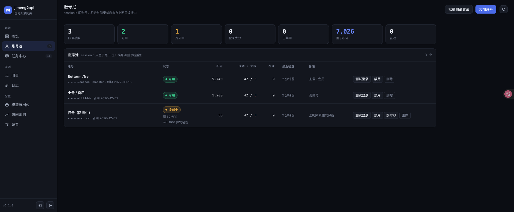

# jimeng2api

国内即梦（`jimeng.jianying.com`）的**账号池网关 + 管理面板**。

对外是 OpenAI 形态的图片生成接口；对内是一套可运营的号池：加号、探活、积分、
冷却、并发闸门、任务轮询、按 submit_id 对账真实扣费。实现逻辑取自
[`rsfree/jimeng`](https://github.com/rsfree/jimeng)（sessionid 鉴权、MD5 sign、
`draft_content` 双重编码、协调器轮询），但**重新组织为单进程 + 单库 + 自带面板**的形态。

> 只做国内站。国际站（Dreamina / `mweb-api-sg.capcut.com`）的站点常量与
> `sg-bridge`（页面上下文过 shark）不在本仓范围。

---

## 1. 快速开始

```bash
# 本机（uv 管理解释器；Python ≥ 3.11）
uv venv --python 3.13
uv pip install -r requirements.txt
uv run uvicorn "app.main:create_app" --factory --port 8300

# 或者 docker（容器以 uid 10001 运行，绑定目录要先给它写权限）
cp .env.example .env
mkdir -p data && sudo chown -R 10001:10001 data
docker compose up -d --build
```

首次启动会生成管理员 Key：

```
data/first_boot_key.txt     # 权限 600，明文只此一份
```

打开 <http://127.0.0.1:8300/panel/>，粘贴 Key 进入。

跑测试：

```bash
uv pip install -r requirements-dev.txt
uv run pytest
```

---

## 2. 加账号：五种方式

| 方式 | 适用场景 | 说明 |
|---|---|---|
| **抖音扫码** | 手机上有抖音 | 服务端无头浏览器走 OAuth，面板显示二维码；服务器无需图形界面 |
| **飞书扫码** | 企业账号绑定了飞书 | 同一条链路，二维码是 canvas，截图逻辑单独适配 |
| **单个粘贴** | 手上有 DevTools | 粘 `sessionid` 或整行 cookie，自动解析 `sid_guard` 到期日 |
| **批量导入** | 几十上百个号 | 一行一个，自动去重（批内 + 池内）+ 4 线程并发探活，逐行返回结果 |
| **远程浏览器** | 手机号/验证码/滑块 | 把服务端浏览器画面与键鼠搬进面板，人直接在页面上操作，登录后自动入池 |

手机号 + 短信验证码不支持**自动化**（滑块/风控无法用脚本硬解），但可以用
**远程浏览器**人工完成：画面实时回传面板，你在自己的浏览器里点输入框、收验证码、
过滑块，服务端浏览器登录成功后会自己把 sessionid 收进池子。

### 单个粘贴

登录 `jimeng.jianying.com` → DevTools → Application → Cookies → 复制
`sessionid` 的值，粘到面板「账号池 → 添加账号」。

**也可以直接粘整行 cookie**（`sessionid=…; sid_guard=…; ttwid=…`）：服务端会取出
`sessionid`，并从 `sid_guard` 的 `<签发秒>|<有效秒>` 解析出**到期日**，显示在账号行上。
库里仍然只存一个 sessionid —— 其余 20 多个键实测都不参与请求，没有保存价值。

这是**唯一硬前提**。实测负对照（2026-09-18，读写端点一致）：完整 cookie jar
27 个键与"只有 sessionid"的返回完全相同；`sign` / `msToken` / `a_bogus` /
`ttwid` 都不是必需。

面板**不会回显完整 sessionid**，只显示尾 6 位。换号 = 删了重加，不提供"查看明文"。

### 远程浏览器（noVNC 的替代）

「账号池 → 远程浏览器」把**服务端 Chromium 的画面和键鼠**搬进面板：

```
Page.startScreencast → JPEG 帧（WebSocket 二进制）→ <canvas>
鼠标/键盘 → Input.dispatchMouseEvent / dispatchKeyEvent → 页面
```

**为什么不是 noVNC**：noVNC 要背 `Xvfb + 窗口管理器 + 有头 Chrome + x11vnc + websockify`
一整套 X11 栈（镜像 +700MB），而且抓到画面之后仍然要另想办法读 HttpOnly 的 sessionid。
CDP 方案复用扫码登录已经装好的那个无头 Chromium，**零额外系统依赖**，并且能直接用
`context.cookies()` 收登录态 —— 既能操作，又能入池。

使用与边界：

* 单会话，最长 10 分钟；关闭弹窗即停（断线保留 90 秒可重连）；
* WebSocket 用**一次性 ticket**（60 秒有效，`POST /panel/api/remote/start` 签发）；
* 每秒检查一次 `sessionid`，检测到就自动入池并提示，不需要手动"抓取"；
* 码率：JPEG q55、隔帧推送（空闲页面几乎不传帧，滚动/视频时才占带宽）。

Nginx 必须放行 WebSocket 升级：

```nginx
location /panel/ws/ {
    proxy_pass http://127.0.0.1:8300;
    proxy_http_version 1.1;
    proxy_set_header Upgrade $http_upgrade;
    proxy_set_header Connection "upgrade";
    proxy_set_header Host $host;
    proxy_read_timeout 900s;
}
```

### 扫码登录（服务器上不用碰浏览器）

面板「账号池 → 扫码登录」会（可选抖音 / 飞书）：

1. 服务端起一个**无头浏览器**，打开即梦登录页；
2. 勾选协议 → 点「抖音登录」/「飞书登录」→ 打开对应 OAuth 二维码；
3. 把二维码截图回传面板（二维码轮换时自动刷新）；
4. 手机抖音扫码确认后，`BrowserContext.cookies()` 拿到 **HttpOnly 的 sessionid**
   （这是从"已登录浏览器"里读不到的那个值），自动入池并探活。

为什么必须这样：`sessionid` 是 HttpOnly，`document.cookie` 读不到；浏览器扩展
按策略也不暴露 cookie。与其去解密 Chrome 的 cookie 库，不如走站点真实的登录流程。

安装（可选依赖，基础镜像不含）：

```bash
uv pip install -r requirements-login.txt
playwright install chromium        # 本机已有 Chrome 时会优先用 chrome channel
# docker：WITH_LOGIN=1 docker compose up -d --build
```

一次只允许一个扫码会话；二维码 5 分钟有效，过期在面板点「重新生成」。
sessionid 只写入本地库，**不回传前端、不打印日志**。

添加后会自动做一次**零成本探活**：

| 步骤 | 接口 | 作用 |
|---|---|---|
| 1 | `POST /commerce/v1/benefits/user_credit` | 判活 + 拿积分（失效必 `1015`） |
| 2 | `POST /mweb/v1/get_common_config` | 拿 `sec_uid`（顺带验证签名） |
| 3 | `POST /mweb/v1/get_user_info` | 拿昵称/uid，失败不影响判活 |

---

## 3. 面板

信息架构对齐 workbuddy2api 的面板：左侧分组导航 + 顶部操作条 + 卡片/表格。


<table><tr>
<td></td>
<td></td>
</tr></table>

| 页面 | 做什么 |
|---|---|
| **概览** | 账号/积分/在途/今日成功率；近 7 天趋势；协调器与能力表状态；异常汇总条 |
| **账号池** | 加号、逐个/批量探活、启用禁用、解冷却、删除；积分与会员等级、成功/失败、最近检查 |
| **任务中心** | 状态筛选、搜索、分页；详情抽屉含产物预览、刷新签名 URL、按 submit_id 对账实扣 |
| **用量** | 近 7/14/30 天：请求、成功/失败、积分；按模型/账号/密钥聚合 |
| **日志** | 请求日志（IP/UA/耗时）+ 上游日志（ret/错误类型/耗时），可只看失败 |
| **模型与档位** | 实时能力表：模型、分辨率档、张数选项、单价（t2i/i2i）、输入图上限；**试玩**（默认 dry-run） |
| **访问密钥** | 业务 Key / 管理员 Key；额度、已用、请求数；明文只显示一次 |
| **设置** | 并发、轮询间隔、超时、冷却、低积分线、默认模型；上游站点只读信息 |

面板自身也用 `Authorization: Bearer <管理员 Key>`，登录只是校验一次；
不引入 session/JWT —— 单机后台，多一套令牌体系只会让"谁能进"更难审计。

### 试玩的计费边界

「构造草稿」**不发任何请求、不扣积分**，只返回将提交的 `draft_content` 与预计积分。
「真实提交」需要先勾选确认、再二次弹窗确认；它走与 API 相同的任务链路。

---

## 4. 对外接口

`Authorization: Bearer sk-…`；`/v1/models`、`/healthz`、`/readyz` 免鉴权。

```bash
# 同步（受理 + 等终态，默认最多 300s；超时返回 202 + poll_url）
curl -s http://127.0.0.1:8300/v1/images/generations \
  -H "Authorization: Bearer $KEY" -H "Content-Type: application/json" \
  -d '{"model":"seedream-5.5","prompt":"一只橘猫，午后逆光","n":2,"size":"2048x2048"}'

# 异步（形状照 SkillHub image-adapter §3：创建 202 + 仅 task_id）
curl -s http://127.0.0.1:8300/async/v1/images/generations \
  -H "Authorization: Bearer $KEY" -H "Content-Type: application/json" \
  -d '{"model":"seedream-5.5","prompt":"赛博朋克雨夜","n":1}'
# → 202 {"task_id":"..."}

curl -s http://127.0.0.1:8300/async/v1/images/generations/<task_id> \
  -H "Authorization: Bearer $KEY"
# → 运行中 202 {"status":"queued|in_progress",...}
# → 成功   200 {"status":"succeeded","data":[{"url":...}]}
# → 失败   200 {"status":"failure","error":{"code":"task_failed|empty_result","message":...}}

# 图生图：image 收 data URI / http(s) URL / tos image_uri，内部自动上传换 uri
curl -s http://127.0.0.1:8300/v1/images/generations \
  -H "Authorization: Bearer $KEY" -H "Content-Type: application/json" \
  -d '{"model":"seedream-5.5","prompt":"改成霓虹配色","image":"https://…/a.jpg"}'
```

模型名支持三种写法：上游 key（`high_aes_general_v55`）、面板名
（`seedream-5.5`）、`default`。完整清单见 `GET /v1/models`。

**异步接口的三条硬约定**（与上游同构，改它等于破坏已接入的客户端）：

| 事项 | 约定 |
|---|---|
| 创建响应 | **202 + 只有 `task_id`** —— 不带 `status`/`poll_url`/`created`：多一个字段客户端就会依赖它 |
| 轮询状态码 | 运行中 **202**、终态 **200** —— 按「202 就是未完成」判会把已结束的请求读成还在跑 |
| 终态词汇 | `succeeded` / `failure`（不是 `success`/`failed`）；失败也是 **200**，错误在 body 的 `error.code` |
| 成功无产物 | 判 `failure` + `code:"empty_result"`，不拿空 `data[]` 冒充成功 |

`id` 与 `task_id` 同值、**只出现在轮询响应**，为按 `id` 解析的老客户端保留。

尺寸会**吸附**到上游的 8 个比例槽与分辨率桶；任何"请求了 A、实际做 B"都写进
响应的 `degradations`，不静默降级。

---

## 5. 架构：五条主线

```
POST /v1/images/generations
      │  只做参数校验 + 落库（queued），请求内零上游往返
      ▼
   SQLite ──► 协调器（唯一执行者，单进程）
                 ├─ 取 queued → 选号 → 上传垫图 → 提交 → running
                 └─ 合并轮询在途任务 → 终态 → 产物 / 错误
```

1. **受理不碰上游。** 建任务是计费动作，必须在有闸门、能重试、能调度账号的地方做。
2. **在途数放在库里数。** `SELECT COUNT(*) WHERE status IN ('submitting','running')`，
   不用内存信号量 —— 进程重启后信号量归零会让上游被超发。
3. **降级必须可见。** 张数吸附、分辨率降档、比例吸附都进 `degradations`。
4. **失败不重发。** 只有上游**明确拒绝**（`1015` / 额度 / 限流 / 风控）才换号重试；
   网络错误/超时一律判"结果未知"，宁可报错也不让同一 prompt 扣两次。
5. **成败只看 `task.status`。** `ret=0` 只代表"请求被受理"；`status=30` 照样计费。

---

## 6. 上游事实（2026-11-18 本机抓包复核）

| 项 | 值 | 依据 |
|---|---|---|
| 签名 | `md5("9e2c|" + path[-7:] + "|7|8.4.0|秒|tdid|11ac")` | 现场抓包验算命中 |
| `da_version` | **3.3.40**（参考仓是 3.3.28） | 页面请求 query |
| `appvr` / `pf` | 8.4.0 / 7（未变） | 请求头 |
| `get_common_config` | **免登录**，但模型表随账号不同（假号 13 个 / 真实号 22 个） | 实测 |
| `/commerce/v1/*` | **校验 sign**：不带 → `1014 system busy`；带上 → `ret=0` | 实测 |
| `get_user_info` | body 必须是 `{"sec_uid": …}`，空 body → `1000 invalid parameter` | 抓包 |
| 提交端点 | `POST /mweb/v1/aigc_draft/generate`；假凭据返回 `1015 login error`（不是 shark 拦截、不是 404） | 实测 |
| 当前图片模型 | 22 个，含 `high_aes_general_v55`（Seedream 5.5，1.5k/2k、1..8 张、1 积分/张） | 实读 |
| 能力表随账号 | 访客/未登录只下发 13 个模型，真实账号 22 个 | 实测 |

⚠️ **能力表是"按账号"的**：不同账号可能看到不同的模型/价格。服务端缓存全局一份，
只有**探活通过**的账号才允许刷新它（未探活的号会把缓存降级成访客表）。

`app/upstream/models_snapshot.json` 是这份能力表的静态快照，只在上游读不到时兜底，
面板会标"快照"而不是假装实时。

---

## 7. 边界（不粉饰）

**未实跑生成。** 本次交付遵守零计费纪律：只调用了免费接口
（`get_common_config` / `get_user_info` / `user_credit` / `user_credit_history`）
与一个**必被拒**的提交探针（假 sessionid → `1015`）。因此：

- `draft_content` 的字段是否被当前版本 100% 接受，**未经一次成功生成验证**；
- 图生图的四段式上传（ImageX + AWS4）已照抓包移植，**未经真实账号跑通**；
- 视频（Seedance）**未实现** —— 参考仓的视频计费白名单本身也只覆盖三档，
  没有新抓包就补只会按错档位扣积分。

**已知风险：**

- 上游存在 `x-secsdk-web-signature` 等运行时头；当前读接口不带也能过，
  写接口在假凭据下先被 `1015` 拦住，无法证伪。真遇到 `1014`，用环境变量
  `JIMENG_SECSDK_SIGNATURE` / `JIMENG_SECSDK_EXPIRE` 注入浏览器抓到的值。
- 面板 Key 存在 `localStorage`，属于自建后台的常见取舍；不要把面板暴露到公网
  而不加一层前置认证（nginx `auth_basic` 或 IP 白名单）。
- SQLite 适合单机单实例。协调器不能多副本 —— 多副本会双提交，这是计费事故，
  不是性能问题。
- **sessionid 在库里是明文**（要用它换上游请求，必须可逆）。保护手段是文件系统权限
  与部署边界，不是应用层加密：面板从不回显完整值，导出/备份数据库时按密钥对待。
- 上传的垫图会留在即梦账号的素材库（`image_uri` 不是内容寻址，同一张图传两次是两个
  uri）。服务内做了内容哈希缓存与 in-flight 去重，但换账号仍会重传。

---

## 8. 部署

```nginx
server {
    listen 443 ssl http2;
    server_name jimeng2api.1task.cn;

    # 运维面（如需）在这里挡掉；面板本身建议再加 auth_basic 或 IP 白名单
    location / {
        proxy_pass http://127.0.0.1:8300;
        proxy_set_header Host $host;
        proxy_set_header X-Forwarded-For $proxy_add_x_forwarded_for;
        proxy_set_header X-Forwarded-Proto $scheme;
        proxy_read_timeout 300s;   # 同步接口最长等 300s
    }
}
```

容器只绑 `127.0.0.1:8300`，公网一律走 nginx（与其它自建服务同一约定）。

---

## 9. 目录

```
app/
  main.py            # 工厂 + 路由 + 请求日志 + 静态资源
  api.py             # /v1/images/generations、/async、/v1/models、/v1/credits
  panel_api.py       # /panel/api/*（登录路由单独挂，不吃 require_admin）
  service.py         # 建任务、选号、提交、轮询、对账
  coordinator.py     # 唯一执行者（单进程）
  pool.py            # 账号运行时、客户端缓存、探活、能力表刷新
  repo.py            # 所有 SQL（账号/任务/密钥/日志/用量/运行期配置）
  db.py              # SQLite schema + 锁
  models.py          # 能力表归一化 + 快照兜底
  security.py        # Key 哈希/校验、首次启动引导
  login_assistant.py # 扫码登录（Playwright + 抖音/飞书 OAuth）
  remote_browser.py  # 远程浏览器（CDP screencast + 键鼠回放 + 登录态收取）
  upstream/
    protocol.py      # 草稿构造（双重编码）、尺寸吸附、任务解析
    sign.py          # MD5 签名 + 真实抓包向量
    client.py        # 唯一 HTTP 收缝
    upload.py        # ImageX 四段式 + AWS4 签名
web/                 # 面板（无构建步骤）
scripts/seed_demo.py # 演示数据（仅本地预览，会清空表）
tests/               # 28 项：签名向量、草稿形态、API 鉴权、任务生命周期、cookie 解析
```

---

## 10. 许可与出处

实现逻辑参考 [`rsfree/jimeng`](https://github.com/rsfree/jimeng)（上游契约、
签名算法、草稿形态、错误码分类）。本项目只做国内站、只做图片，并把
"账号池 + 面板"作为一等公民。
