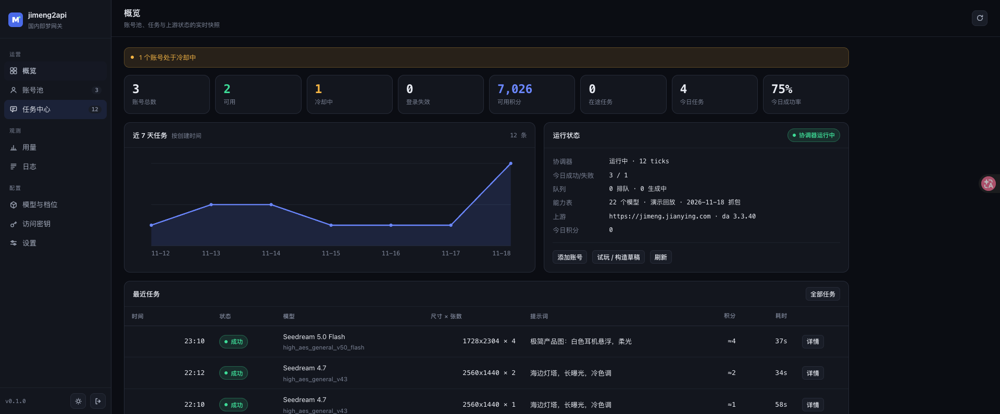
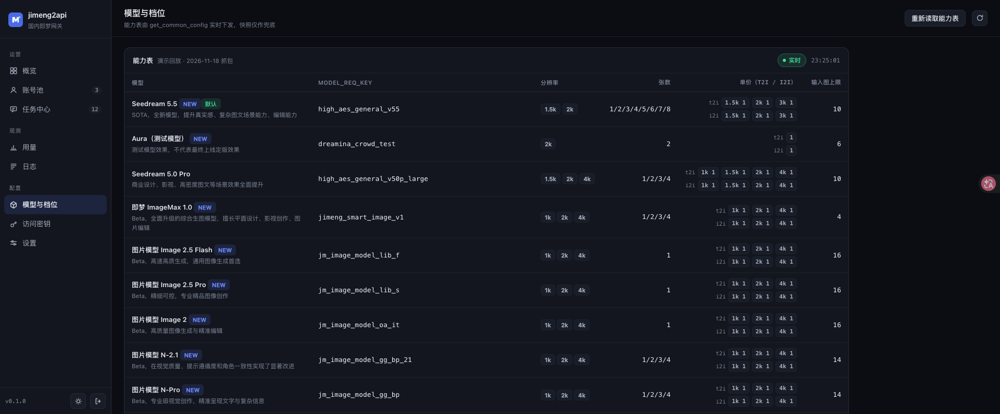

# jimeng2api

国内即梦（`jimeng.jianying.com`）的**账号池网关 + 管理面板**。

对外是 OpenAI 形态的图片生成接口；对内是一套可运营的号池：加号、探活、积分、
冷却、并发闸门、任务轮询、按 submit_id 对账真实扣费。实现逻辑取自
[`rsfree/jimeng`](https://github.com/rsfree/jimeng)（sessionid 鉴权、MD5 sign、
`draft_content` 双重编码、协调器轮询），但**重新组织为单进程 + 单库 + 自带面板**的形态。

> 只做国内站。国际站（Dreamina / `mweb-api-sg.capcut.com`）的站点常量与
> `sg-bridge`（页面上下文过 shark）不在本仓范围。

---

## 1. 快速开始

```bash
# 本机（uv 管理解释器；Python ≥ 3.11）
uv venv --python 3.13
uv pip install -r requirements.txt
uv run uvicorn "app.main:create_app" --factory --port 8300

# 或者 docker（容器以 uid 10001 运行，绑定目录要先给它写权限）
cp .env.example .env
mkdir -p data && sudo chown -R 10001:10001 data
docker compose up -d --build
```

首次启动会生成管理员 Key：

```
data/first_boot_key.txt     # 权限 600，明文只此一份
```

打开 <http://127.0.0.1:8300/panel/>，粘贴 Key 进入。

跑测试：

```bash
uv pip install -r requirements-dev.txt
uv run pytest
```

---

## 2. 加账号：五种方式

| 方式 | 适用场景 | 说明 |
|---|---|---|
| **抖音扫码** | 手机上有抖音 | 服务端无头浏览器走 OAuth，面板显示二维码；服务器无需图形界面 |
| **飞书扫码** | 企业账号绑定了飞书 | 同一条链路，二维码是 canvas，截图逻辑单独适配 |
| **单个粘贴** | 手上有 DevTools | 粘 `sessionid` 或整行 cookie，自动解析 `sid_guard` 到期日 |
| **批量导入** | 几十上百个号 | 一行一个，自动去重（批内 + 池内）+ 4 线程并发探活，逐行返回结果 |
| **远程浏览器** | 手机号/验证码/滑块 | 把服务端浏览器画面与键鼠搬进面板，人直接在页面上操作，登录后自动入池 |

手机号 + 短信验证码不支持**自动化**（滑块/风控无法用脚本硬解），但可以用
**远程浏览器**人工完成：画面实时回传面板，你在自己的浏览器里点输入框、收验证码、
过滑块，服务端浏览器登录成功后会自己把 sessionid 收进池子。

### 单个粘贴

登录 `jimeng.jianying.com` → DevTools → Application → Cookies → 复制
`sessionid` 的值，粘到面板「账号池 → 添加账号」。

**也可以直接粘整行 cookie**（`sessionid=…; sid_guard=…; ttwid=…`）：服务端会取出
`sessionid`，并从 `sid_guard` 的 `<签发秒>|<有效秒>` 解析出**到期日**，显示在账号行上。
库里仍然只存一个 sessionid —— 其余 20 多个键实测都不参与请求，没有保存价值。

这是**唯一硬前提**。实测负对照（2026-09-18，读写端点一致）：完整 cookie jar
27 个键与"只有 sessionid"的返回完全相同；`sign` / `msToken` / `a_bogus` /
`ttwid` 都不是必需。

面板**不会回显完整 sessionid**，只显示尾 6 位。换号 = 删了重加，不提供"查看明文"。

### 远程浏览器（noVNC 的替代）

「账号池 → 远程浏览器」把**服务端 Chromium 的画面和键鼠**搬进面板：

```
Page.startScreencast → JPEG 帧（WebSocket 二进制）→ <canvas>
鼠标/键盘 → Input.dispatchMouseEvent / dispatchKeyEvent → 页面
```

**为什么不是 noVNC**：noVNC 要背 `Xvfb + 窗口管理器 + 有头 Chrome + x11vnc + websockify`
一整套 X11 栈（镜像 +700MB），而且抓到画面之后仍然要另想办法读 HttpOnly 的 sessionid。
CDP 方案复用扫码登录已经装好的那个无头 Chromium，**零额外系统依赖**，并且能直接用
`context.cookies()` 收登录态 —— 既能操作，又能入池。

使用与边界：

* 单会话，最长 10 分钟；关闭弹窗即停（断线保留 90 秒可重连）；
* WebSocket 用**一次性 ticket**（60 秒有效，`POST /panel/api/remote/start` 签发）；
* 每秒检查一次 `sessionid`，检测到就自动入池并提示，不需要手动"抓取"；
* 码率：JPEG q55、隔帧推送（空闲页面几乎不传帧，滚动/视频时才占带宽）。

Nginx 必须放行 WebSocket 升级：

```nginx
location /panel/ws/ {
    proxy_pass http://127.0.0.1:8300;
    proxy_http_version 1.1;
    proxy_set_header Upgrade $http_upgrade;
    proxy_set_header Connection "upgrade";
    proxy_set_header Host $host;
    proxy_read_timeout 900s;
}
```

### 扫码登录（服务器上不用碰浏览器）

面板「账号池 → 扫码登录」会（可选抖音 / 飞书）：

1. 服务端起一个**无头浏览器**，打开即梦登录页；
2. 勾选协议 → 点「抖音登录」/「飞书登录」→ 打开对应 OAuth 二维码；
3. 把二维码截图回传面板（二维码轮换时自动刷新）；
4. 手机抖音扫码确认后，`BrowserContext.cookies()` 拿到 **HttpOnly 的 sessionid**
   （这是从"已登录浏览器"里读不到的那个值），自动入池并探活。

为什么必须这样：`sessionid` 是 HttpOnly，`document.cookie` 读不到；浏览器扩展
按策略也不暴露 cookie。与其去解密 Chrome 的 cookie 库，不如走站点真实的登录流程。

安装（可选依赖，基础镜像不含）：

```bash
uv pip install -r requirements-login.txt
playwright install chromium        # 本机已有 Chrome 时会优先用 chrome channel
# docker：WITH_LOGIN=1 docker compose up -d --build
```

一次只允许一个扫码会话；二维码 5 分钟有效，过期在面板点「重新生成」。
sessionid 只写入本地库，**不回传前端、不打印日志**。

添加后会自动做一次**零成本探活**：

| 步骤 | 接口 | 作用 |
|---|---|---|
| 1 | `POST /commerce/v1/benefits/user_credit` | 判活 + 拿积分（失效必 `1015`） |
| 2 | `POST /mweb/v1/get_common_config` | 拿 `sec_uid`（顺带验证签名） |
| 3 | `POST /mweb/v1/get_user_info` | 拿昵称/uid，失败不影响判活 |

---

## 3. 面板

信息架构对齐 workbuddy2api 的面板：左侧分组导航 + 顶部操作条 + 卡片/表格。



<table><tr>
<td></td>
<td></td>
</tr></table>

| 页面 | 做什么 |
|---|---|
| **概览** | 账号/积分/在途/今日成功率；近 7 天趋势；协调器与能力表状态；异常汇总条 |
| **账号池** | 加号、逐个/批量探活、启用禁用、解冷却、删除；积分与会员等级、成功/失败、最近检查 |
| **任务中心** | 状态筛选、搜索、分页；详情抽屉含产物预览、刷新签名 URL、按 submit_id 对账实扣 |
| **用量** | 近 7/14/30 天：请求、成功/失败、积分；按模型/账号/密钥聚合 |
| **日志** | 请求日志（IP/UA/耗时）+ 上游日志（ret/错误类型/耗时），可只看失败 |
| **模型与档位** | 实时能力表：模型、分辨率档、张数选项、单价（t2i/i2i）、输入图上限；**模型重定向**（对外名 → 本网关模型，支持批量导入）；**后编辑工具表**（形态 / ability_code / gen_type / 输入约束 / 档位 / 是否要 mask / 取证记录）；**试玩**（默认 dry-run） |
| **访问密钥** | 业务 Key / 管理员 Key；额度、已用、请求数；明文只显示一次 |
| **设置** | 并发、轮询间隔、超时、冷却、低积分线、默认模型；上游站点只读信息 |

面板自身也用 `Authorization: Bearer <管理员 Key>`，登录只是校验一次；
不引入 session/JWT —— 单机后台，多一套令牌体系只会让"谁能进"更难审计。

### 试玩的计费边界

「构造草稿」**不发任何请求、不扣积分**，只返回将提交的 `draft_content` 与预计积分。
「真实提交」需要先勾选确认、再二次弹窗确认；它走与 API 相同的任务链路。

---

## 4. 对外接口

`Authorization: Bearer sk-…`；`/v1/models`、`/healthz`、`/readyz` 免鉴权。

```bash
# 同步（受理 + 等终态，默认最多 300s；超时返回 202 + poll_url）
curl -s http://127.0.0.1:8300/v1/images/generations \
  -H "Authorization: Bearer $KEY" -H "Content-Type: application/json" \
  -d '{"model":"seedream-5.5","prompt":"一只橘猫，午后逆光","n":2,"size":"2048x2048"}'

# 异步（形状照 SkillHub image-adapter §3：创建 202 + 仅 task_id）
curl -s http://127.0.0.1:8300/async/v1/images/generations \
  -H "Authorization: Bearer $KEY" -H "Content-Type: application/json" \
  -d '{"model":"seedream-5.5","prompt":"赛博朋克雨夜","n":1}'
# → 202 {"task_id":"..."}

curl -s http://127.0.0.1:8300/async/v1/images/generations/<task_id> \
  -H "Authorization: Bearer $KEY"
# → 运行中 202 {"status":"queued|in_progress",...}   响应带 Retry-After
# → 成功   200 {"status":"succeeded","data":[{"url":...}]}
# → 失败   200 {"status":"failure","error":{"code":"…","message":...}}

# 图生图：image 收 data URI / http(s) URL / tos image_uri，内部自动上传换 uri
curl -s http://127.0.0.1:8300/v1/images/generations \
  -H "Authorization: Bearer $KEY" -H "Content-Type: application/json" \
  -d '{"model":"seedream-5.5","prompt":"改成霓虹配色","image":"https://…/a.jpg"}'
```

模型名用 `GET /v1/models` 里的 `id`（如 `seedream-5.5`，默认模型带
`"default": true`）或 `default`。旧的上游 key（`high_aes_general_v55`）
**仍被接受**，但不再对外公布 —— 清单里不出现它，也不出现积分单价：
`id` 是对外别名，价格是渠道成本结构，两者都留在网关内部。

### 4.1 模型重定向（对外名 → 本网关模型）

面板「模型与档位 → 模型重定向」里配置：调用方用各厂商官网的模型名请求，
网关负责映射到本网关模型（也可映射到后编辑工具）。

```json
{"model": "doubao-seedream-4-0-250828", "prompt": "一只橘猫"}
// 面板里配 doubao-seedream-4-0-250828 → seedream-4.0 即按 Seedream 4.0 执行
```

| 规则 | 说明 |
|---|---|
| 解析顺序 | **用户重定向** → 内置对外 ID / 上游 key / 面板名 / slug |
| 大小写 | 不敏感（存储归一化为小写） |
| 链式 | 支持 A→B→模型，最多 4 跳；**成环直接 400** |
| 遮蔽 | 不能把对外名设成内置模型名/工具名（如 `seedream-5.5`、`jimeng-hd`）—— 那会静默改掉老客户端的行为 |
| 目标 | 必须是能力表里**现在能提交**的模型或后编辑工具；能力表变了导致目标失效时，面板标红 + 概览告警 |
| 对外公布 | 别名会出现在 `GET /v1/models`（生成模型在 `data[]`，带 `alias_of`；工具在 `tools[]`），客户端不必猜拼写 |
| 响应回显 | 传别名就回别名；任务行里存的仍是上游 key / 能力 id（成本与排障口径不变） |

批量导入支持每行 `对外名 => 目标`（`->` / `→` / Tab 亦可），或直接粘 JSON。
调用方不需要改代码，换模型只改这张表。

### 4.2 后编辑工具（超清 / 细节修复 / 扩图）

同一端点、同一套轮询，靠 `model` 选能力 —— **后编辑不需要 prompt**：

```bash
# 超清：把任意图放大加细节
curl -s http://127.0.0.1:8300/v1/images/generations \
  -H "Authorization: Bearer $KEY" -H "Content-Type: application/json" \
  -d '{"model":"jimeng-hd","image":"https://…/a.jpg"}'

# 普通超清：任意图（origin_image 必须是对象，见 docs/UPSTREAM-TOOLS.md §4.2.2）
curl -s http://127.0.0.1:8300/v1/images/generations \
  -H "Authorization: Bearer $KEY" -H "Content-Type: application/json" \
  -d '{"model":"超清","image":"https://…/a.jpg"}'

# 细节修复：只认账号已有作品，传 item:<item_id>:<history_id>
#   这两个值**就在生成结果里**：每个产物都带 item_id 与 history_id
#   {"url":"…","item_id":"7709905466289196350","history_id":"51910303526668"}
#   ⚠️ item 引用绑账号：网关会锁定产出它的那个号，那个号不可用时**直接失败**
#      而不是换号重试（detail_fix 用错号会失败且计费）
curl -s http://127.0.0.1:8300/v1/images/generations \
  -H "Authorization: Bearer $KEY" -H "Content-Type: application/json" \
  -d '{"model":"jimeng-detail-fix","image":"item:7696399061636910361:47490120999948"}'

# 扩图：ratio 与 scale 二选一（选了 ratio，scale 不参与）
curl -s http://127.0.0.1:8300/v1/images/generations \
  -H "Authorization: Bearer $KEY" -H "Content-Type: application/json" \
  -d '{"model":"扩图","image":"https://…/a.jpg","ratio":"16:9"}'

# 智能编辑：整图 + 描述（prompt 必填）
curl -s http://127.0.0.1:8300/v1/images/generations \
  -H "Authorization: Bearer $KEY" -H "Content-Type: application/json" \
  -d '{"model":"智能编辑","image":"https://…/a.jpg","prompt":"把红色方块换成一只猫"}'

# 可带画布标记（brush / arrow，坐标 0-1）
#   ⚠️ 标记只是给模型看的视觉标注，**不约束编辑范围** —— 要精确控区用「局部重绘」
-d '{"model":"智能编辑","image":"…","prompt":"把红色方块换成一只猫",
     "markers":[{"type":"brush","points":[[0.42,0.70],[0.58,0.84]]}]}'
```

| 模型 | 能力 | 输入 | 状态 |
|---|---|---|---|
| `jimeng-hd`（别名 `超清`/`变清晰`/`超分`） | `normal_hd`，gen_type 13 | 上传图 / 作品引用 | **已实测**：1024→2048 出图，**未扣费**（2 次样本） |
| `jimeng-detail-fix`（`细节修复`） | `super_resolution`，gen_type 2 | **仅**作品引用 | **已实测**：成功输出 1920×1920、未扣费；**带上传图会失败且计费**（所以入口锁死） |
| `jimeng-pro-hd`（`智能超清`） | `pro_hd`，gen_type 35 | 上传图 | **已实测**：2K 实扣 19 积分，`resolution` 选 2k/4k/8k（同价） |
| `jimeng-inpaint`（`局部重绘`） | `inpainting`（unified），gen_type 7 | 上传图 + **mask** | **已实测**：1 积分/4 张，只改蒙版区域 |
| `jimeng-erase`（`消除笔`/`擦除`） | `inpainting_remove`（unified），gen_type 9 | 上传图 + **mask** | **已实测**：1 积分/1 张，只改蒙版区域 |
| `jimeng-cutout`（`抠图`/`去背景`） | `saliency_seg` | 上传图 | **已实测**：免费、1.9s、返回透明底 PNG（**同步**，不进队列） |
| `jimeng-outpaint`（`扩图`） | `outpainting`（unified），gen_type 8 | 上传图 | **已实测**：1 积分/4 张，`ratio=16:9` 输出 1820×1024 |
| `jimeng-smart-edit`（`智能编辑`） | `smart_edit_v2`（unified_v2），gen_type 101 | 上传图 + **prompt**（可选 `markers`） | **已实测**：档位 1k~8k（价格随档位变：1.5k=4 积分、2k=6 积分），默认 1.5k |

**交付形态：后编辑默认异步。** 在 `POST /v1/images/generations` 上不占连接等待，
直接返回 `202 {"task_id","poll_url"}` —— 2K 超清实测 38.5s，4K/8K 更久，等到超时
再降级会让「降级」变成常态。要同步就显式传 `"wait": 120`，或把运行参数
`postedit_sync_wait` 调大（面板可改，0 = 不同步）。

**智能编辑走另一套 v2 草稿**（`unified_generate_v2`，gen_type 101）：提示词挂在
能力节点上、资源节点带**签名 URL**、多一个 `extra` 画布快照、`extend` 里多
`root_model`；`prompt` 必填。`markers` 收 `brush` / `arrow` 两种画布元素
（0-1 归一化坐标），但**它不约束编辑范围** —— 实测同一份 markers 下，
prompt 写"把红色方块换成…"是局部、写"把标记的区域变成…"就整图重绘。
要精确控区请用 `jimeng-inpaint`。细节见 [`docs/UPSTREAM-TOOLS.md`](docs/UPSTREAM-TOOLS.md) §4.5。

后编辑族里 `mask` 的真实载体是 `resource_list` 的 `purpose`：`11`=原图、`12`=蒙版，
蒙版是普通 PNG（**白=要改的区域，黑=保持**），与原图同尺寸。

扩图**不需要 mask**，它的目标尺寸由 `ratio`/`scale` 推出，落到上游
`option.out_painting` 的四边扩展浮点上（短边不动、长边按比例扩展）。

**异步接口的硬约定**（与上游同构，改它等于破坏已接入的客户端）：

| 事项 | 约定 |
|---|---|
| 创建响应 | **202 + 只有 `task_id`** —— 不带 `status`/`poll_url`/`created`：多一个字段客户端就会依赖它 |
| 轮询状态码 | 运行中 **202**、终态 **200** —— 按「202 就是未完成」判会把已结束的请求读成还在跑 |
| 终态词汇 | `succeeded` / `failure`（不是 `success`/`failed`）；失败也是 **200**，错误在 body 的 `error.code` |
| 产物载体 | **只交付 `http(s)` URL**：`data[]` 里没有 `b64_json` 键，`url` 不以 `data:` 开头 |
| 缓存与退避 | 创建与轮询一律 `Cache-Control: no-store`；运行中带 `Retry-After`（秒） |

**错误只有一个信封**，同步与异步一致：

```json
{"error": {"code": "invalid_request", "message": "size 需形如 2048x2048"}}
```

只有 `code` 与 `message` 两个键 —— 不放 `kind`、`ret`、上游 errmsg。分层规则：

| 面 | 看得到什么 |
|---|---|
| 客户端（`/v1/*`、`/async/*`） | 稳定错误码 + 固定文案；`message` 只说**客户端能改什么** |
| 服务端（`/panel/api/*`、`tasks.error`、`upstream_logs`） | 上游原文、`ret`、`error_kind`、耗时 —— 排障用 |

同步 / 请求级错误的码：

| HTTP | code | 何时 |
|---|---|---|
| 400 | `invalid_request` | 本地校验失败 / 上游拒收 / 内容审核 |
| 401 | `invalid_api_key` | 缺失或无效的 Bearer |
| 402 | `insufficient_quota` | 该 Key 额度用尽 |
| 403 | `permission_denied` | Key 无权执行 |
| 404 | `not_found` | 任务不存在（含"不属于你"） |
| 422 | `invalid_request` | 请求体格式错误（只回字段路径，**不回显 input**） |
| 429 | `rate_limited` | 上游限流，带 `Retry-After` |
| 500 | `internal_error` | 网关自身异常 |
| 502 | `upstream_error` | 上游凭证失效 / 额度不足 / 风控 / 网络 |
| 503 | `executor_unavailable` | 执行器不健康 |

异步终态的失败码（`status:"failure"` 时）是另一套四型：

| code | 含义 | 客户端该做什么 |
|---|---|---|
| `task_failed` | 上游生成失败 / 超时 / 网络中断 | 可重试 |
| `invalid_request` | 参数或内容被上游拒绝 | 改请求，重试无用 |
| `empty_result` | 上游标记成功但没产出图片 | 可重试（多为上游空跑） |
| `carrier_unavailable` | 上游只回了内联图片（b64 / data URI） | 重试无用，需换渠道 |

这四个码的 `message` 是**固定字符串**：`ret=…`、上游 errmsg、失败星灵 key
都不会出现在里面。

以下字段被收下，但**没有对应能力，不要指望生效**：

- `response_format`：即梦不提供 b64 交付，同步与异步恒为 `url`。传 `b64_json`
  照常受理、不报错 —— 不因一个无法兑现的传输偏好否掉一次可满足的生成，
  但拿回来的仍是链接。
- `mask`：**局部重绘需要它**（白=重绘区域、黑=保持，与原图同尺寸）。
  其它能力不消费 mask，传了不会报错，但 `degradations` 会写「不消费 mask，
  该字段未下发上游」—— 静默丢弃会让调用方以为局部重绘生效了。文生图 / 图生图路径仍按"无此参数"丢弃。

`n` 不设死上限：由能力表的张数选项吸附到最近的合法档位，`n ≤ 0` 回落 1。
**吸附结果不返回给客户端** —— 那是运营细节（"该模型无 4k 档，改用 2k"），
只写进任务行，面板任务详情可见。同步端点超时降级成异步时，`status` 用**同一套
客户端词汇**（`in_progress`），不会在换端点时冒出一个内部的 `running`。

`id` 与 `task_id` 同值、**只出现在轮询响应**，为按 `id` 解析的老客户端保留。

`/v1/credits` 只回**本 Key** 的额度（`quota` / `used` / `remaining`）；
池子里有几个账号、各剩多少属于运维数据，只对管理员 Key 返回。

同一原则适用于能力清单：`/v1/models` 的 `id` 是**对外别名**，不返回上游
`model_req_key`，也不返回 `prices`（上游积分单价）与 `live` / `source`
（能力表是否实时读取）。后编辑清单同样只留 `id` / `name` / `kind` / `input` /
`resolutions` / `needs_mask` / `ratios` / `scales` —— `ability` / `gen_type` /
`shape` / `notes` 是草稿构造细节与取证记录。排障要的全量视图在
`/panel/api/models` 的 `tools[]`（含这些内部字段与逐条取证 `notes`），
面板的「模型与档位」页会把它们渲染成表。

### 4.3 视频（文生视频）

视频是**第三套草稿**（`video_base_component` + `gen_video`），与图片、后编辑都不是
一回事：`generate_type` 是**字符串**、参数全在 `abilities.gen_video` 里、
`extend.root_model` 等于模型的 `model_req_key`。

```bash
# 5 秒 / 720p，走默认模型（Seedance 2.0 mini）
curl -s http://127.0.0.1:8300/v1/images/generations \
  -H "Authorization: Bearer $KEY" -H "Content-Type: application/json" \
  -d '{"model":"视频生成","prompt":"一只橘猫在窗台上伸懒腰","duration":5,
       "resolution":"720p","ratio":"16:9"}'
```

产物与图片同一个 `data[]`，靠 `type` 区分：

```json
{"type": "video", "url": "https://…/x.mp4", "format": "mp4",
 "width": 1280, "height": 720, "resolution": "720p",
 "duration": 5, "fps": 24, "cover_url": "https://…/cover.jpeg",
 "item_id": "7710070900703661337", "history_id": "51869467820556"}
```

| 项 | 值 | 证据 |
|---|---|---|
| 模型 | `jimeng-video`（默认）/ `-fast` / `-pro` / `-25` | 从视频专用 config 端点取全表，见 `docs/UPSTREAM-VIDEO.md` |
| `duration` | 4~15 秒（越界按边界吸附并在 `degradations` 说明） | config 下发的 `4000~15000ms` |
| `resolution` | `720p` / `1080p` | config 下发 |
| 扣费 | 2.0 mini **≈6 积分/秒**（4s=24、5s=30）；2.5 Flash **≈19 积分/秒**（4s=76） | 三次真实提交 |
| 耗时 | 约 **5 分钟**（48 次轮询），远慢于图片 | 实测 |

**图生视频**：传 `image` 就是首帧（1 张），两张则是首帧 + 尾帧。

```bash
curl -s http://127.0.0.1:8300/v1/images/generations \
  -H "Authorization: Bearer $KEY" -H "Content-Type: application/json" \
  -d '{"model":"视频生成","prompt":"缓慢推近","duration":5,
       "image":["https://…/start.jpg","https://…/end.jpg"]}'
```

实测：首帧确实被当作视频起点（抽出第一帧与原图对比，构图一致），4s 扣 24 积分。

⚠️ 两点必须知道：

1. **视频很慢**。同步端点（`/v1/images/generations`）的 `sync_timeout` 对视频几乎
   必然不够，请用异步端点（`/async/v1/...`）拿 `task_id` 再轮询。
2. **同步慢不代表失败**。上游在生成期间一直回 `submitted`，直到 48 次轮询后才
   `success` —— 别按图片的耐心判超时。

---

## 5. 架构：五条主线

```
POST /v1/images/generations
      │  只做参数校验 + 落库（queued），请求内零上游往返
      ▼
   SQLite ──► 协调器（唯一执行者，单进程）
                 ├─ 取 queued → 选号 → 上传垫图 → 提交 → running
                 └─ 合并轮询在途任务 → 终态 → 产物 / 错误
```

1. **受理不碰上游。** 建任务是计费动作，必须在有闸门、能重试、能调度账号的地方做。
2. **在途数放在库里数。** `SELECT COUNT(*) WHERE status IN ('submitting','running')`，
   不用内存信号量 —— 进程重启后信号量归零会让上游被超发。
3. **降级必须可见，但只对运维可见。** 张数吸附、分辨率降档、比例吸附都进
   `degradations` 并落库；客户端响应里一个字段都不出现。
4. **失败不重发。** 只有上游**明确拒绝**（`1015` / 额度 / 限流 / 风控）才换号重试；
   网络错误/超时一律判"结果未知"，宁可报错也不让同一 prompt 扣两次。
5. **成败只看 `task.status`。** `ret=0` 只代表"请求被受理"；`status=30` 照样计费。

---

## 6. 上游事实（2026-11-18 本机抓包复核）

| 项 | 值 | 依据 |
|---|---|---|
| 签名 | `md5("9e2c|" + path[-7:] + "|7|8.4.0|秒|tdid|11ac")` | 现场抓包验算命中 |
| `da_version` | **3.3.40**（参考仓是 3.3.28） | 页面请求 query |
| `appvr` / `pf` | 8.4.0 / 7（未变） | 请求头 |
| `get_common_config` | **免登录**，但模型表随账号不同（假号 13 个 / 真实号 22 个） | 实测 |
| `/commerce/v1/*` | **校验 sign**：不带 → `1014 system busy`；带上 → `ret=0` | 实测 |
| `get_user_info` | body 必须是 `{"sec_uid": …}`，空 body → `1000 invalid parameter` | 抓包 |
| 提交端点 | `POST /mweb/v1/aigc_draft/generate`；假凭据返回 `1015 login error`（不是 shark 拦截、不是 404） | 实测 |
| 当前图片模型 | 22 个，含 `high_aes_general_v55`（Seedream 5.5，1.5k/2k、1..8 张、1 积分/张） | 实读 |
| 能力表随账号 | 访客/未登录只下发 13 个模型，真实账号 22 个 | 实测 |

⚠️ **能力表是"按账号"的**：不同账号可能看到不同的模型/价格。服务端缓存全局一份，
只有**探活通过**的账号才允许刷新它（未探活的号会把缓存降级成访客表）。

`app/upstream/models_snapshot.json` 是这份能力表的静态快照，只在上游读不到时兜底，
面板会标"快照"而不是假装实时。

---

## 7. 边界（不粉饰）

**未实跑生成。** 本次交付遵守零计费纪律：只调用了免费接口
（`get_common_config` / `get_user_info` / `user_credit` / `user_credit_history`）
与一个**必被拒**的提交探针（假 sessionid → `1015`）。因此：

- `draft_content` 的字段是否被当前版本 100% 接受，**未经一次成功生成验证**；
- 图生图的四段式上传（ImageX + AWS4）已照抓包移植，**未经真实账号跑通**；
- 视频（Seedance）**未实现** —— 参考仓的视频计费白名单本身也只覆盖三档，
  没有新抓包就补只会按错档位扣积分。

**已知风险：**

- 上游存在 `x-secsdk-web-signature` 等运行时头；当前读接口不带也能过，
  写接口在假凭据下先被 `1015` 拦住，无法证伪。真遇到 `1014`，用环境变量
  `JIMENG_SECSDK_SIGNATURE` / `JIMENG_SECSDK_EXPIRE` 注入浏览器抓到的值。
- 面板 Key 存在 `localStorage`，属于自建后台的常见取舍；不要把面板暴露到公网
  而不加一层前置认证（nginx `auth_basic` 或 IP 白名单）。
- SQLite 适合单机单实例。协调器不能多副本 —— 多副本会双提交，这是计费事故，
  不是性能问题。
- **同一份数据库只能有一个服务在跑，端口不同也算多副本**。2026-11-19 实测踩到：
  8300 与 8322 两个服务共用 `data/jimeng2api.db`，队列里的任务被**旧代码的那个进程**
  抢走，于是用别的分支提交并报出一个与当前代码无关的错（`prompt 不能为空`）。
  排查手法：
  ```bash
  lsof -nP -iTCP:8300-8399 -sTCP:LISTEN          # 谁在监听
  lsof -a -p <pid> -d cwd -Fn                     # 它跑的是哪个目录
  ```
  表现特征是「任务行明明存在，但错误信息来自另一条分支」—— 那不是代码 bug，
  先数进程。
- **sessionid 在库里是明文**（要用它换上游请求，必须可逆）。保护手段是文件系统权限
  与部署边界，不是应用层加密：面板从不回显完整值，导出/备份数据库时按密钥对待。
- 上传的垫图会留在即梦账号的素材库（`image_uri` 不是内容寻址，同一张图传两次是两个
  uri）。服务内做了内容哈希缓存与 in-flight 去重，但换账号仍会重传。

---

## 8. 部署

```nginx
server {
    listen 443 ssl http2;
    server_name jimeng2api.1task.cn;

    # 运维面（如需）在这里挡掉；面板本身建议再加 auth_basic 或 IP 白名单
    location / {
        proxy_pass http://127.0.0.1:8300;
        proxy_set_header Host $host;
        proxy_set_header X-Forwarded-For $proxy_add_x_forwarded_for;
        proxy_set_header X-Forwarded-Proto $scheme;
        proxy_read_timeout 300s;   # 同步接口最长等 300s
    }
}
```

容器只绑 `127.0.0.1:8300`，公网一律走 nginx（与其它自建服务同一约定）。

---

## 9. 目录

```
app/
  main.py            # 工厂 + 路由 + 请求日志 + 静态资源
  api.py             # /v1/images/generations、/async、/v1/models、/v1/credits
  panel_api.py       # /panel/api/*（登录路由单独挂，不吃 require_admin）
  service.py         # 建任务、选号、提交、轮询、对账
  coordinator.py     # 唯一执行者（单进程）
  pool.py            # 账号运行时、客户端缓存、探活、能力表刷新
  repo.py            # 所有 SQL（账号/任务/密钥/日志/用量/运行期配置）
  db.py              # SQLite schema + 锁
  models.py          # 能力表归一化 + 快照兜底
  security.py        # Key 哈希/校验、首次启动引导
  login_assistant.py # 扫码登录（Playwright + 抖音/飞书 OAuth）
  remote_browser.py  # 远程浏览器（CDP screencast + 键鼠回放 + 登录态收取）
  upstream/
    protocol.py      # 草稿构造（双重编码）、尺寸吸附、任务解析
    sign.py          # MD5 签名 + 真实抓包向量
    client.py        # 唯一 HTTP 收缝
    upload.py        # ImageX 四段式 + AWS4 签名
web/                 # 面板（无构建步骤）
scripts/
  seed_demo.py       # 演示数据（仅本地预览，会清空表）
  capability_audit.py # 能力自检：零请求，验草稿结构与取证是否一致
  postedit_probe.py  # 后编辑探针：默认 dry-run，双闸门才真提交
tests/               # 122 项：签名向量、草稿逐字段对拍、API 鉴权、任务生命周期
```

---

## 10. 许可与出处

实现逻辑参考 [`rsfree/jimeng`](https://github.com/rsfree/jimeng)（上游契约、
签名算法、草稿形态、错误码分类）。本项目只做国内站、只做图片，并把
"账号池 + 面板"作为一等公民。
